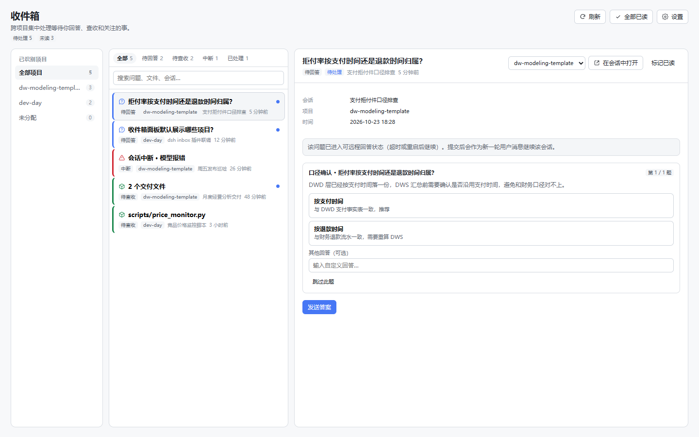

# dsh-inbox

> 仓库名 `dsh-inbox`，npm 包名 `dsh-inbox-plugin`（`dsh-inbox` 在 npm 上已被他人占用）。

DSH（DeepSeek Harness）插件：把**等你回答的问题、等你查收的交付、以及中断的回合**汇总到一个跨项目收件箱里，并在面板内直接处理。

适配基线：**DSH 0.2.1-rc.2**（npm `latest`），兼容探测 **0.2.1-rc.3**（npm `next`，2026-10-23 发布）。DSH 0.2.1-rc.2 的 `ui-user-questions` 明确把「跨会话问题收件箱」列为未建能力；本插件补的就是这一块。



## 它解决什么

DSH 原生的待办分散在各自会话里：问题只在当前会话输入框上方的卡片出现，交付只在回合末尾出现，宿主崩溃/模型报错留下的中断要回到会话里才发现。`dsh-inbox` 把这三类信号抽出来，按项目归组，形成一个全局面板：

- **收件箱**：问题、交付、中断同列表；紧急的排前面。查看只标记已读，不消失；只有回答、查收、继续或忽略才结算。
- **自动归组**：扫描你配置的项目目录，按会话 `cwd`、标题、首条用户消息判断归属；判断不出来就落在「未分配」，可手动指定，手动优先。
- **原地处理**：在面板里回答 continued 问题、给中断会话补一句话继续、预览并查收交付、忽略不需要的条目；需要时可一键跳回原会话。
- **中断补报**：监听 `turn/end` 的 `error` / `interrupted`，并在启动时回扫最近会话；对于日志里有 `turn/start` 却没有 `turn/end`、且会话不在运行的冷会话，补一条「未闭合回合」告警。重启前发生的中断也能补出来。
- **按会话聚合**：列表按「今天 / 昨天 / 本周 / 更早」的时间流铺开，一行一个会话，显示该会话的待处理数量与类型；点开看它下面的全部问题、交付和中断，不再被同一会话的多条记录刷屏。
- **历史不占待办**：超过 `backfillDays`（默认 7 天）的条目自动归档，只在「历史」筛选里可见，不进入待处理统计。

## 安装

### 桌面版（Electron）

在 DSH 的插件管理器里添加 Bundle：

```text
https://codeload.github.com/SophiaData/dsh-inbox/tar.gz/refs/tags/v0.1.1
```

桌面版的 Profile 由 Electron 管理，不要用下面的 CLI 命令向 `desktop` Profile 安装。

### CLI 管理的 Profile

```sh
dsh plugin --profile web add \
  "https://codeload.github.com/SophiaData/dsh-inbox/tar.gz/refs/tags/v0.1.1" \
  --registry https://registry.npmjs.org/
```

把 `web` 换成目标 Profile。使用 HTTPS 源码包可以避开 Git/SSH 的 `Host key verification failed`。安装返回 `restart-required` 时，重启 DSH 生效。

`v0.1.1` 是发布 tag，装的是固定版本；升级时把 tag 换成最新版本（见仓库 Releases）。想跟随主干可改用 `refs/heads/main`。

本地开发也可以直接挂载 checkout：

```sh
dsh plugin --profile web add E:\dsh-inbox
```

## 第一次使用

1. 打开左侧栏的 **收件箱** 图标（有未读时图标右上角显示数字）。
2. 点右上角 **设置**，添加项目目录，例如 `E:\dev-day`、`E:\dw-modeling-template`，点 **保存并扫描**。
3. 插件扫描每个目录的**直接子目录**作为项目；带 `.git`、`package.json`、`pyproject.toml`、`go.mod` 等标记的目录会带上标记。
4. 会话按以下顺序归组：
   - 手动指定（最高优先级）；
   - 会话 `cwd` 落在项目路径下（嵌套项目取最长路径）；
   - 标题/首条用户消息里出现项目名、目录名或 `package.json` 的 `name`；同名并列时保持未分配。
5. 识别不出来的会话显示在 **未分配**，在详情页的项目下拉里手动指定。

也可以直接在 Profile 的 `cordis.patch.yml` 里写初始目录：

```yaml
- insert:
    - id: dsh-inbox
      name: dsh-inbox-plugin
      config:
        projectRoots:
          - E:\dev-day
          - E:\dw-modeling-template
        lookbackDays: 30
        backfillDays: 7
        scanIntervalSeconds: 60
```

面板里保存的目录会写入插件状态文件，不改 patch、不触发插件重载。

## 三类条目的判定

| 类型 | 来源 | 结算方式 |
| --- | --- | --- |
| 待回答 | `userQuestions` 会话投影里的 `active` 问题，含 `open` 与 `continued` | 面板提交答案；问题在别处被回答后投影消失，自动结算 |
| 待查收 | `deliverables/presented` 事件（`present` 工具声明的最终文件） | 预览后点「已查收」或「忽略」 |
| 中断 | `turn/end` 的 `reason.kind === 'error'` / `'interrupted'`；`api-session/error`；未闭合且未运行的回合 | 「继续会话」或「知道了」/「忽略」 |

排序优先级：`open` 问题 > 中断 > `continued` 问题 > 交付；同优先级未读在前，再按更新时间倒序。

「查看」只写 `readAt`，不会改变 `state`。面板轮询只读快照，因此打开面板不会结算任何条目。

## 原地处理的边界

DSH 0.2.1-rc.2 的官方远程接口只允许对 **continued** 问题调用 `userQuestions.answer`。仍在原会话前台等待的 **open** 问题必须由前台 answerer 回答，官方没有提供跨面板接管的 Remote：

- **continued 问题**（超时/重启后继续）：在面板里直接选答案并提交，答案作为 `user-question-reply` 继续该会话。
- **open 问题**：面板仍展示完整问题与选项；提交时会尝试远程回答，若 DSH 返回「仍在前台等待」，面板给出错误并提供 **在会话中打开**，不会伪造答案。
- **中断继续**：通过 `sessionController.prompt` 以 `queue` 模式发送一条用户消息（默认「继续」），打开新回合。
- **交付查收**：只接受该会话 `deliverables/presented` 里声明过的文件预览/定位，避免任意读文件。

这是当前 DSH 的接口边界，不是插件偷懒；等官方开放 open 问题的跨面板回答后，这里可以无缝接上。

## 中断补报怎么工作

- **实时**：监听 `session/event` 的 `turn/end`；`error` 记录模型/上游错误码与消息，`interrupted` 记录宿主重启/崩溃后的合成 closer。
- **启动回扫**：插件启动后第一次全量扫描最近 `lookbackDays` 天（默认 30）的会话，补出插件安装/重启前发生的中断。
- **未闭合回合**：冷会话日志以 `turn/start` 结尾、没有 `turn/end`，且 `running === false` 时补一条 `open-turn` 告警；如果之后该回合以正常原因结束，自动结算这条误报。
- **去重**：以 `interruption:<sessionId>:<turn>` 为条目 id；同一回合的 `open-turn` 与后续 `error`/`interrupted` 会合并，不会重复刷屏。
- **Agent 回合外错误**：`api-session/error` 按「会话 + 分钟 + 消息哈希」去重。

## 数据与隐私

- 收件箱状态只写本机：`<profile>/.dsh-inbox/state.json`（`profileContext.dir` 不可用时退回 `~/.dsh/.dsh-inbox/state.json`），文件权限 `0600`。
- 不联网、不上传、不读取凭据；不写 `cordis.patch.yml`。
- 本地只存判断所需的最小内容：会话标题、首条用户消息前 600 字、问题文本/选项、交付文件路径、错误码与消息。**完整会话历史仍只在 DSH 自己的日志里**。
- 所有 RPC 只接受本机 owner 会话；写操作还要求 `interactions === 'answer'`。非 owner 得到 `INBOX_FORBIDDEN`。
- 删除状态：停止插件后删除上述 `state.json` 即可；不会影响 DSH 会话。

## 兼容性

- `package.json` 声明 `engines.dsh: ">=0.2.1-rc.2 <0.3.0"`，覆盖 rc.2 与 rc.3。
- 读取侧探测 `sessionController.list/inspect/projections`、`userQuestions.answer`、`sessionController.prompt/openWorkspacePath`；缺失的能力在面板「设置 → 运行信息」里标为不可用，对应入口降级而不是崩溃。
- 写入侧只写自己的状态文件，不依赖 `configEditor` 或 patch 写入，因此不会因为 Profile 只读而失效。
- 版本探测用 `@deepseek-ai/dsh/package.json`，不访问网络；版本未知时仍可读，面板显示 `—`。

## 已知限制

- **open 问题不能真正跨面板回答**：见上一节；这是 DSH 0.2.1-rc.2 的接口边界。
- **交付只认 `present` 工具**：`workspace/changes` 的变更摘要只活在 Host 内存里，DSH 重启后无法回读，因此不作为持久收件项；它仍会在原会话末尾显示。
- **项目扫描只到一级子目录**：这是「配置项目目录」的语义；更深的嵌套请在配置里直接加该目录。
- **自动归组是启发式**：标题/首条消息里同时出现多个项目名时保持未分配，避免猜错；手动指定永远优先。
- **冷会话首次扫描有成本**：全量回扫会 `inspect` 最近会话；`maxSessions` 默认 300，可用 `lookbackDays` / `maxSessions` 收紧。
- **桌面版与 CLI 的 Profile 不同**：桌面版请在插件管理器安装，不要对 `desktop` Profile 跑 `dsh plugin`。
- **历史自动归档**：`createdAt` 早于 `backfillDays`（默认 7 天）的条目会转为「历史」，不占待处理；想回溯更久就调大该值，想更干净就调小。
- **聚合粒度是会话**：同一会话的多条事件在一行里展示，忽略/结算仍按单条处理。

## 开发

```sh
npm install
npm test          # 31 个单测/集成测试
npm run check     # 语法检查
npm run pack:check
```

仓库结构：

```text
index.js              Host 入口 + RPC 路由
lib/service.js        扫描、归组、收件箱状态机、回答/继续/预览
lib/events.js         会话日志 → 问题/交付/中断事实
lib/grouping.js       项目目录扫描与归组
lib/store.js          原子持久化与条目生命周期
client.js             浏览器插件（主面板 + 侧栏入口）
test/                 单测、Host 集成、客户端加载、视觉 harness
docs/DESIGN.md        契约、状态机、RPC 表、失败模式
```

本地视觉 harness：`test/harness.html` + `test/harness.js` 用示例数据渲染面板，便于在改样式时截图对比；它不随 npm 包发布。

## License

MIT
